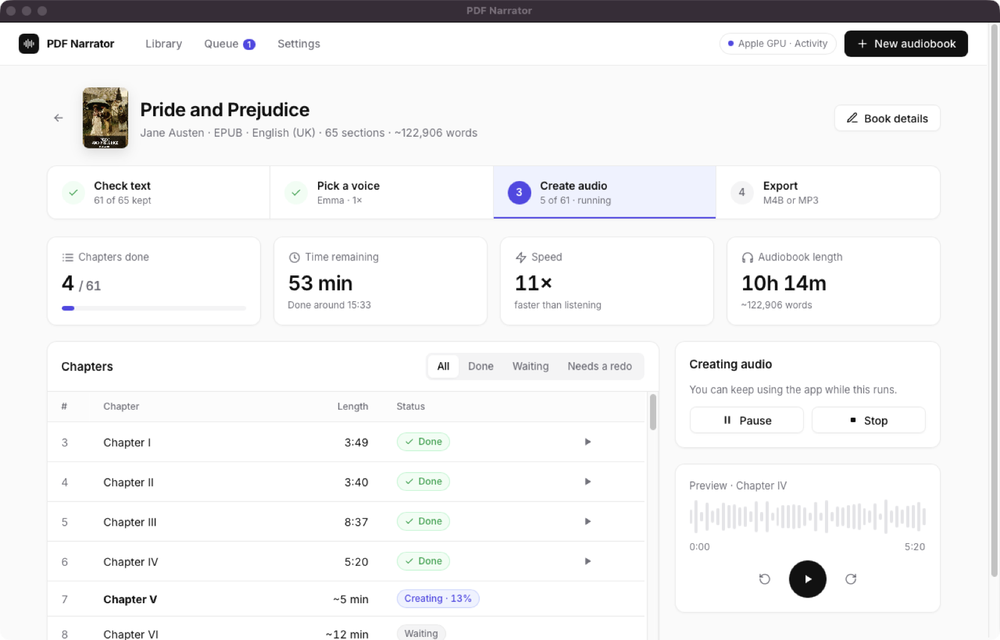
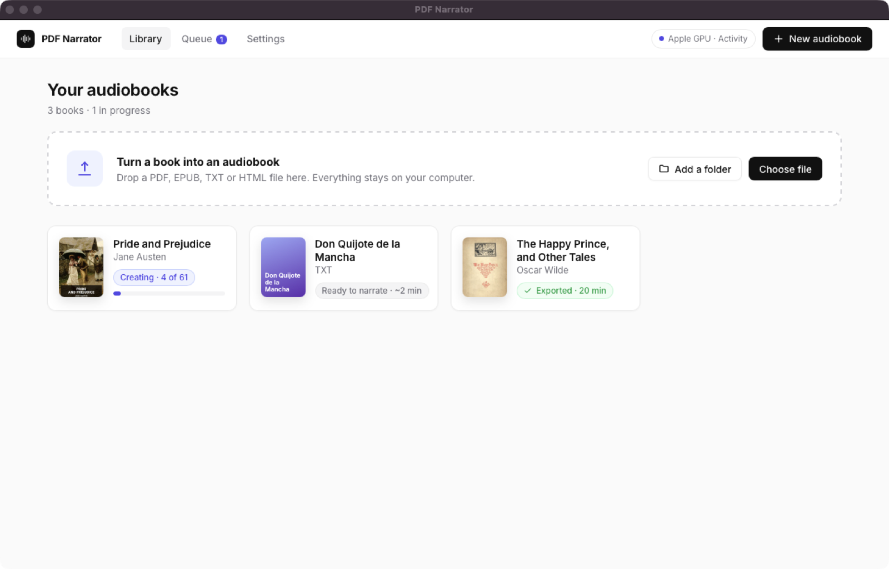
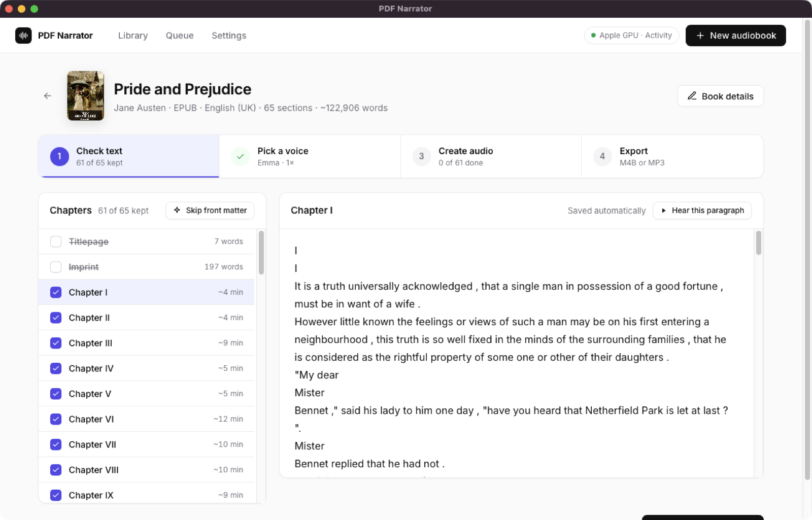
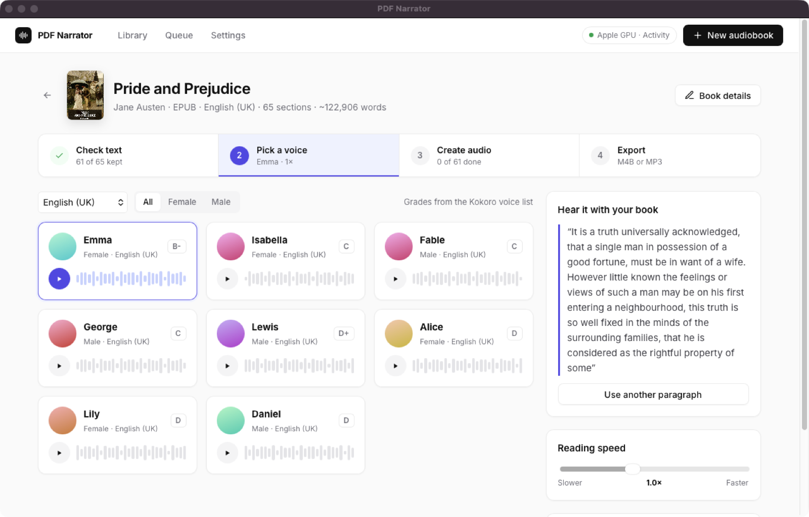
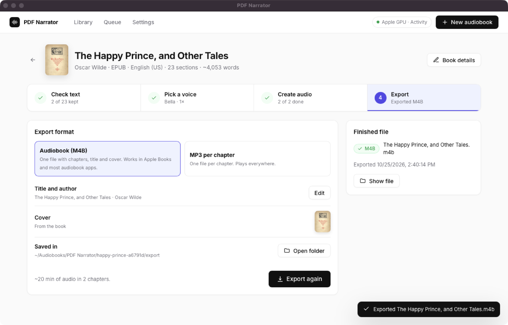
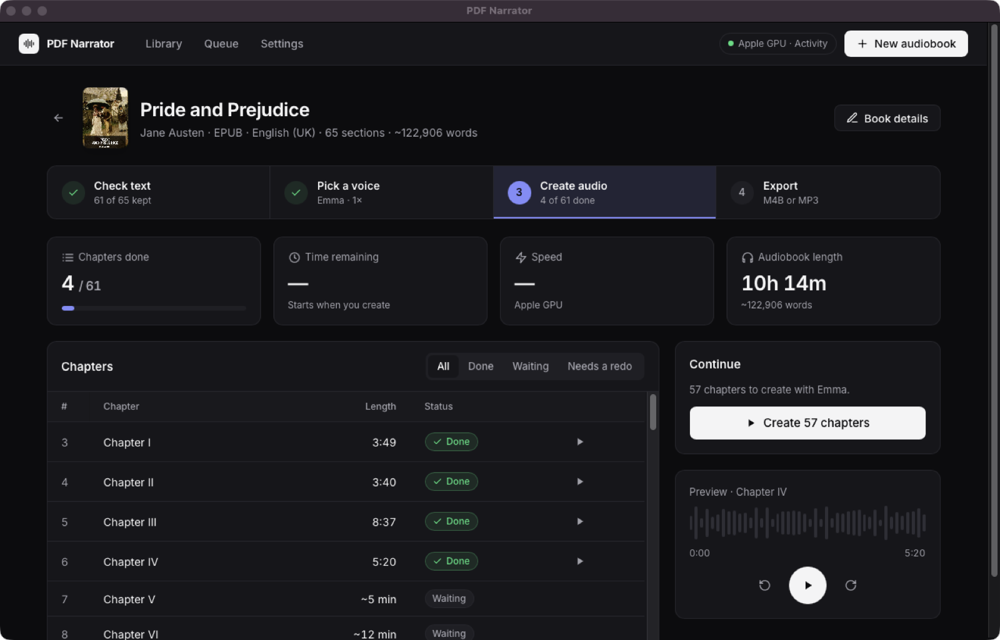

# PDF Narrator

PDF Narrator turns PDF, EPUB, TXT and HTML books into audiobooks. It uses [Kokoro-82M](https://huggingface.co/hexgrad/Kokoro-82M), a speech model that runs on your computer. Your books do not go to the internet.



> For a reader that shows the text while the audio plays, see [Cadence](https://github.com/mateogon/Cadence).

## Contents

1. [Features](#features)
2. [Requirements](#requirements)
3. [Install](#install)
4. [Make an audiobook](#make-an-audiobook)
5. [Where your files are](#where-your-files-are)
6. [Command line](#command-line)
7. [Optional setups](#optional-setups)
8. [Troubleshooting](#troubleshooting)
9. [Development](#development)
10. [License](#license)

## Features

- **Desktop app.** A library of your books and a four-step flow: check the text, pick a voice, create the audio, export.
- **Local speech.** Kokoro runs on the CPU, on an Apple GPU (MPS) or on an NVIDIA GPU (CUDA). The app selects the fastest one.
- **Fast.** On an Apple M-series GPU, the app creates audio about 10 to 13 times faster than real time.
- **Clean text.** The app skips covers, copyright pages, contents and Project Gutenberg license text. You can edit any chapter before you create audio.
- **54 voices in 9 languages.** You hear each voice read a paragraph from your own book. Each voice shows its quality grade from Kokoro.
- **Audiobook export.** M4B with chapters, title, author and cover, or one MP3 file for each chapter.
- **Safe to stop.** You can pause, stop and continue. Finished chapters stay finished. If you edit a chapter, the app creates only that chapter again.

## Requirements

| Item | Requirement |
|---|---|
| Operating system | macOS, Windows 10/11 or Linux |
| Tools | [uv](https://docs.astral.sh/uv/getting-started/installation/) and Git |
| Disk space | About 2 GB for Python packages, plus about 350 MB for the speech model |
| Internet | Only for the first install and the first use of each voice |
| M4B export (optional) | [FFmpeg](https://ffmpeg.org/download.html) |
| Scanned PDFs (optional) | Tesseract and Poppler. See [Scanned PDFs](#scanned-pdfs-ocr) |

You do not need to install Python, CUDA, eSpeak, Java or DeepSpeed. uv installs the correct Python version and all packages.

## Install

1. Install uv.
   - macOS and Linux:
     ```bash
     curl -LsSf https://astral.sh/uv/install.sh | sh
     ```
   - Windows (PowerShell):
     ```powershell
     powershell -ExecutionPolicy ByPass -c "irm https://astral.sh/uv/install.ps1 | iex"
     ```
2. Linux only: install the system web view and the tools to build its Python bindings (Ubuntu or Debian):
   ```bash
   sudo apt install gir1.2-webkit2-4.1 libgirepository-2.0-dev libcairo2-dev pkg-config python3-dev
   ```
   On Linux, start the app with `uv run --with "pywebview[gtk]" pdf-narrator` in step 5. macOS and Windows already include a web view.
   > **Note:** The desktop app is not yet tested on Linux. The command line works without these packages.
3. Optional: install FFmpeg for M4B export.
   - macOS: `brew install ffmpeg`
   - Windows: `winget install Gyan.FFmpeg`
   - Ubuntu or Debian: `sudo apt install ffmpeg`
4. Download PDF Narrator.
   ```bash
   git clone https://github.com/mateogon/pdf-narrator.git
   cd pdf-narrator
   ```
5. Start the app.
   ```bash
   uv run pdf-narrator
   ```

The first start takes a few minutes, because uv downloads the packages. Later starts take a few seconds.

To update PDF Narrator later, run `git pull` in the `pdf-narrator` folder.

## Make an audiobook



### Step 1: Add a book

1. Drag a PDF, EPUB, TXT or HTML file into the window, or click **Choose file**.
2. Wait a few seconds. The app reads the book and finds its chapters, title, author, cover and language.

To add many books, click **Add a folder**. The app adds all supported files in that folder to the library.

### Step 2: Check the text



1. Look at the chapter list. Sections without a check mark are skipped. The app skips covers, contents, copyright pages and very short sections.
2. Click a chapter to read its text.
3. Correct the text if necessary. The app saves your changes automatically.
4. If the app finds a repeated page header, click **Remove all** to delete it from the chapter.
5. Click **Continue to voice**.

### Step 3: Pick a voice



1. Make sure that the language is correct. The voices change with the language.
2. Click the play button on a voice. You hear that voice read a paragraph from your book.
3. Click a voice card to select it.
4. Optional: move the **Reading speed** slider.
5. Click **Create audiobook**.

The first sample takes about 10 seconds, because the app loads the speech model. Later samples are faster.

### Step 4: Create the audio

1. Wait while the app creates each chapter. The page shows the time remaining and the speed.
2. Optional: click the play button on a finished chapter to listen to it.
3. To stop for now, click **Pause** or **Stop**. Finished chapters stay finished. Click **Create** again to continue.

> **Note:** The first time, the app downloads the speech model (about 350 MB). This can take a few minutes.

### Step 5: Export



1. Select a format:
   - **Audiobook (M4B):** one file with chapters, title, author and cover. Use it with Apple Books and most audiobook apps. M4B needs FFmpeg.
   - **MP3 per chapter:** one MP3 file for each chapter. It plays on all devices.
2. Click **Export audiobook**.
3. Click **Show file** to open the folder.

The app also has a dark mode. To use it, open **Settings** and select **Dark** or **System**.



## Where your files are

The app keeps a library in `~/Audiobooks/PDF Narrator`. To change this folder, open **Settings > General > Library folder**.

Each book has its own folder:

| Folder or file | Content |
|---|---|
| `book.json` | Title, author, language, voice and chapter status |
| `source/` | A copy of the file that you added. The app does not change your original file |
| `text/` | The text of each chapter |
| `chapters/` | The audio of each chapter (WAV) |
| `export/` | The finished audiobook (M4B or MP3) |

To delete a book, open the book, click **Book details**, then click **Remove from library**. This deletes the library copy only.

## Command line

You can also make an audiobook without the window:

```bash
uv run pdf-narrator book.epub --voice af_heart --format m4b
```

More examples:

```bash
uv run pdf-narrator book.pdf --voice ef_dora --lang e --output-dir ./audio
uv run pdf-narrator book.txt --device cpu --format mp3
uv run pdf-narrator book.epub --format m4b --title "My book" --author "An author"
uv run pdf-narrator book.epub --resume
uv run pdf-narrator --help
```

| Option | Values | Default |
|---|---|---|
| `--voice` | A Kokoro voice ID, for example `af_heart`, `bf_emma`, `ef_dora` | `af_heart` |
| `--lang` | `a` US English, `b` UK English, `e` Spanish, `f` French, `h` Hindi, `i` Italian, `j` Japanese, `p` Brazilian Portuguese, `z` Mandarin | First letter of the voice |
| `--device` | `auto`, `cpu`, `mps`, `cuda` | `auto` |
| `--speed` | Reading speed, for example `0.9` or `1.2` | `1.0` |
| `--format` | `wav`, `mp3`, `m4b` | `wav` |
| `--resume` | Use chapters that are already finished, if the text, settings and audio did not change | Off |

Rules:

- The voice must match the language. Voices that start with `a` or `b` are English; voices that start with `e` are Spanish.
- With `--format m4b`, the `.m4b` file goes to the output folder. The chapter WAV files stay in `chapters/` inside that folder, so that `--resume` can use them again.
- `uv run pdf-narrator --ui classic` opens the previous Tk window. It needs a Python build with Tk.

## Optional setups

### NVIDIA GPU (Windows and Linux)

1. Make sure that you have a current NVIDIA driver. You do not need the CUDA Toolkit.
2. Run the app or the command line with the CUDA packages:
   ```bash
   uv run --no-default-groups --extra cuda pdf-narrator
   ```
3. Use the same flags each time. Without them, uv installs the CPU packages again.

This option is not for macOS. On a Mac, the app uses the Apple GPU (MPS) automatically.

### Scanned PDFs (OCR)

A scanned PDF has images of pages, not text. To read it, the app needs optical character recognition (OCR).

1. Install Tesseract and Poppler:
   - macOS: `brew install tesseract poppler`
   - Ubuntu or Debian: `sudo apt install tesseract-ocr poppler-utils`
   - Windows: install [Tesseract](https://tesseract-ocr.github.io/tessdoc/Installation.html) and [Poppler](https://pdf2image.readthedocs.io/en/latest/installation.html). Then add their program folders to `PATH`.
2. Start the app with the OCR packages:
   ```bash
   uv run --extra ocr pdf-narrator
   ```
3. Check the text in **Check text** before you create the audio. OCR can make mistakes.

OCR uses the default Tesseract language and removes the top and bottom 10% of each page.

### Languages

Kokoro has voices for US and UK English, Spanish, French, Hindi, Italian, Brazilian Portuguese, Japanese and Mandarin. Japanese and Mandarin need extra packages that the default install does not include. See [Kokoro's documentation](https://github.com/hexgrad/kokoro). Kokoro does not support Indonesian.

For English books, the app changes numbers and abbreviations into words. For other languages, the app keeps them as they are.

## Troubleshooting

| Problem | Cause | What to do |
|---|---|---|
| The first sample or the first chapter is slow | The app downloads and loads the speech model | Wait. This occurs only the first time |
| **Couldn't read** on a book | The file has no text, or the file is damaged | For a scanned PDF, set up [OCR](#scanned-pdfs-ocr). Then click **Try again** |
| A chapter contains page headers or page numbers | PDF layouts are different from book to book | Edit the text in **Check text**, or click **Remove all** on the suggestion |
| **Audiobook (M4B)** is not available | FFmpeg is not installed | Install FFmpeg, or export MP3 |
| The window does not open on Linux | The web view or its Python bindings are missing | Do step 2 of [Install](#install), then start with `uv run --with "pywebview[gtk]" pdf-narrator` |
| Something else | — | Open **Settings > About > Show diagnostics**, then copy the text into a [GitHub issue](https://github.com/mateogon/pdf-narrator/issues) |

To see what the app is doing, click **Activity** at the top right. The **Details** tab shows technical messages.

## Development

1. Install the development packages:
   ```bash
   uv sync --locked --group dev
   ```
2. Run the tests:
   ```bash
   uv run --locked --group dev pytest -q
   ```

The code has these parts:

| Part | Files | Job |
|---|---|---|
| Text extraction | `extract.py` | Read PDF, EPUB, TXT and HTML; split chapters; clean the text |
| Speech | `generate_audiobook_kokoro.py` | Send text to Kokoro in paragraph blocks; write audio while it is created |
| Export | `audiobook_export.py` | Make M4B files with FFmpeg |
| Library | `library.py`, `voices.py` | Keep books on disk; track the status of each chapter |
| Jobs | `jobs.py` | Run import, create and export jobs in the background |
| Desktop app | `webui/` | Window ([pywebview](https://pywebview.flowrl.com/)), local server and interface |
| Command line | `cli.py` | Make audiobooks without the window |

Notes:

- `pyproject.toml` declares the dependencies. `uv.lock` records the exact versions.
- The `preshed` pin prevents a spaCy failure that occurs with newer versions on macOS.
- The desktop window loads its interface from a local server on `127.0.0.1`. The server uses a random port and a session token, and it only serves files from the library folder.
- `PDF_NARRATOR_CONFIG_DIR` changes the settings folder. Use it for tests or a portable setup.

### What has been tested

| Platform | Tested |
|---|---|
| Ubuntu, Windows, macOS | Automatic tests on CPU in [CI](https://github.com/mateogon/pdf-narrator/actions/workflows/ci.yml), including real OCR on Ubuntu |
| macOS, Apple M-series | Desktop app from start to export; speech on CPU and MPS |
| Windows 11, RTX 3050 | Command line on CPU and CUDA. The new desktop app is not yet tested on Windows |

## License

[MIT](LICENSE.md). Kokoro and its model weights use the [Apache 2.0 license](https://huggingface.co/hexgrad/Kokoro-82M).
